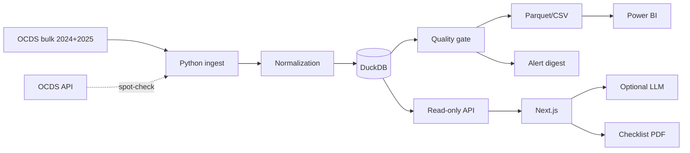

# ContrataMYPE

**Public procurement, explained for small businesses.**

ContrataMYPE turns Peru's open contracting data (OECE, OCDS standard) into an
opportunity search for micro and small enterprises, a participation checklist,
and a reproducible dashboard of the public procurement market.

> **Status:** v1.1.0 — 2024 + 2025 cohorts, web/API, dashboard, alerts and a verifiable bundle. The MYPE user test remains a pending manual validation.
> See [`ROADMAP.md`](ROADMAP.md) and [`docs/v1.1-plan.md`](docs/v1.1-plan.md).

---

## Problem

A small business does not know which tenders fit its sector, region and size,
which documents it needs, or when the deadline closes. Analysts lack a simple
view of the market, and buyers cannot see competition clearly. The data exists
in OCDS but is dispersed and technical.

ContrataMYPE answers:

- Which opportunities are compatible with my sector, region and size?
- Which requirements and deadlines should I review?
- How concentrated is the market by region, category and buyer?
- What quality evidence backs these numbers?

## Users

1. **MYPE** — search, understand and download a checklist.
2. **Analyst/journalist** — market dashboard and exploration.
3. **Buyer/entity** — read-only market and competition view.

## What v1.1.0 includes

- **Next.js web app** with text, region, category (OCDS sector), amount, method and **year (All/2024/2025)** filters. Status is not reported in the bulks; the UI explains it.
- **Opportunity detail** with buyer, object, value, dates, category and official links.
- **MYPE fit** heuristic (amount > 0 + category + region), labelled “compatible”,
  never as legal eligibility.
- **Checklist/PDF** with steps and documents.
- **Explainer** with a deterministic template, citations and disclaimer; an optional Gemini adapter can rewrite only the introduction.
- **Power BI dashboard** with the 2024–2025 market, year selector, region/category/amount/evolution and MYPE participation.
- **Alerts** via CSV/email digest and a Power Automate adapter (license permitting).
- **Data quality** with 12 checks, coverage audits and checksums.

## Data source

- **OCDS / OECE** — Open Contracting portal.
- Annual JSONL bulks: `2024.jsonl.gz` and `2025.jsonl.gz` from `https://data.open-contracting.org/es/publication/135/download?name=<year>.jsonl.gz`.
- 2024: **125.6 MB compressed**, same-year cohort **46,328**; 2025: **148.7 MB**, cohort **59,141**.
- Merged 2024–2025 cohort (including cross-year updates): **64,783 + 59,148 = 123,931 processes**.
- API: `https://contratacionesabiertas.oece.gob.pe/api/v1` (beta; 20 processes/page).
- Fields: `ocid`, buyer, `parties` (RUC/department), `tender` (title, description,
  category, method, value, dates), `awards`, `contracts`.

Raw files are never committed. Provenance, hashes and profile live in
`data/raw/README.md` and `docs/`.

## 2024–2025 findings

- **123,931 processes** worth **S/ 158.34 billion**; **58,380 (47.1%)** match the
  MYPE heuristic but account for only **S/ 5.77 billion (3.6% of value)**.
- By year: 2024 = **64,783 processes / S/ 91.70 billion / 28,458 MYPE**;
  2025 = **59,148 / S/ 66.64 billion / 29,922 MYPE**.
- `goods` (56,420) and `services` (54,120) carry the MYPE share; `works`
  (13,391) is excluded from the rule and explains the value gap.
- **14,335 processes (11.6%)** report amount 0 (“not reported”) and are not
  marked compatible; **116,384 (93.9%)** report start = end.
- 94,570 processes (76.3%) have an award and 85,496 (69.0%) a contract.
- 2025 details and SQL in [`docs/market-findings-2025.md`](docs/market-findings-2025.md); multi-year plan in [`docs/v1.1-plan.md`](docs/v1.1-plan.md).

## Architecture



**Stack:** Python 3.13, DuckDB/PyArrow, FastAPI, Next.js (App Router, TypeScript),
Power BI (PBIP/PBIX), Playwright, pytest, Ruff.

## Repository layout

| Path | Contents |
|---|---|
| `contratamype/` | OCDS ingestion, normalization, DuckDB, 12 checks, exports and digest |
| `api/` | Read-only FastAPI over DuckDB |
| `web/` | Next.js App Router, search, detail, checklist and PDF |
| `dashboard/` | Power BI PBIP/PBIX and screenshots |
| `tests/e2e/` | Pipeline, alerts and release E2E |
| `tools/` | Audits and reproducible samples |
| `docs/` | Decisions, dictionary, quality, findings and limits |
| `data/raw/`, `data/processed/`, `artifacts/` | Local data/artifacts (gitignored) |

## Running it

```bash
# 1. Pipeline (local bulks)
python -m contratamype run \
  --input data/raw/ocds/2024.jsonl.gz \
  --input data/raw/ocds/2025.jsonl.gz \
  --artifacts artifacts/2025 \
  --db data/processed/contratamype.duckdb

# 2. Read-only API
uvicorn api.app:app --port 8000

# 3. Web
cd web && npm install && npm run dev

# 4. Alert digest (2024–2025 cohorts)
python -m contratamype digest --artifacts artifacts/2025 --since 2024-01-01

# 5. Tests
pytest -m fast     # seconds, default
pytest -m slow     # full 2024+2025 bulks, checkpoint only
```

## Testing

| Tier | Command | When | Coverage |
|---|---|---|---|
| Fast | `pytest -m fast` | After every change; seconds | Deterministic fixtures, gate, exports, digest, release |
| Slow | `pytest -m slow` | Checkpoint/release only; ~55 s | Real 2024+2025 bulks (local, gitignored) |
| Full | `pytest -m "fast or slow"` | Before closing a release | Fast + slow |
| Web | `cd web && npx playwright test` | When touching web/API | 23 E2E on a deterministic seed |
| Power BI | `powerbi-report-author validate` + screenshots | When touching the dashboard | PBIR/PBIP and visual evidence |

`pytest.ini` excludes `slow` by default. CI runs `pytest -m fast` plus Playwright;
the bulk is never uploaded.

## Quality and limits

- The MYPE rule is a **compatibility heuristic**, not legal advice.
- No scraping of SEACE/OECE: only open data, API and bulk.
- Data may contain duplicates, zero amounts, incomplete dates and suppliers
  without an address; these are reported, not hidden.
- The dashboard and web app do not replace the official portals or deadlines.
- No user accounts or payments in v1.1.0.

## License and attribution

Code MIT. Data: OECE, Portal de Contrataciones Abiertas, OCDS standard,
redistributed by the Open Contracting Partnership Registry under **CC BY 4.0**.
ContrataMYPE is not affiliated with OECE.
