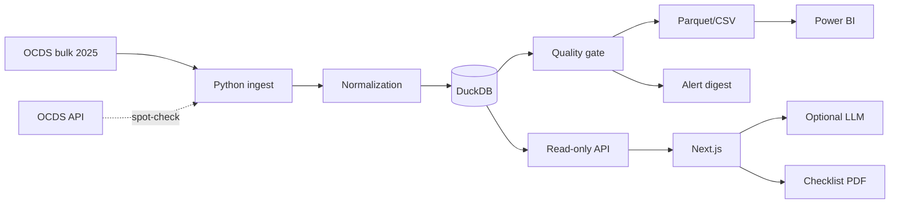

# ContrataMYPE

**Public procurement, explained for small businesses.**

ContrataMYPE turns Peru's open contracting data (OECE, OCDS standard) into an
opportunity search for micro and small enterprises, a participation checklist,
and a reproducible dashboard of the public procurement market.

> **Status:** v1.0.0 — 2025 cohort (59,141 processes out of 124,538 updates).
> See [`ROADMAP.md`](ROADMAP.md) for evidence per phase.

---

## Problem

A small business does not know which tenders fit its sector, region and size,
which documents it needs, or when the deadline closes. Analysts lack a simple
view of the market, and buyers cannot see competition clearly. The data exists
in OCDS but is dispersed and technical.

ContrataMYPE answers:

- Which opportunities are compatible with my sector, region and size?
- Which requirements and deadlines should I review?
- How concentrated is the market by region, category and buyer?
- What quality evidence backs these numbers?

## Users

1. **MYPE** — search, understand and download a checklist.
2. **Analyst/journalist** — market dashboard and exploration.
3. **Buyer/entity** — read-only market and competition view.

## What v1.0.0 includes

- **Next.js web app** with text, region, category, amount and status filters.
- **Opportunity detail** with buyer, object, value, dates, category and official links.
- **MYPE fit** heuristic (amount + category + region), labelled “compatible”,
  never as legal eligibility.
- **Checklist/PDF** with steps and documents.
- **LLM explainer** limited to official fields, with citations and disclaimer;
  template fallback when no API key is available.
- **Power BI dashboard** with market by region/category/amount/evolution and
  MYPE participation.
- **Alerts** via CSV/email digest and a Power Automate adapter (license permitting).
- **Data quality** with validations, report and checksums.

## Data source

- **OCDS / OECE** — Open Contracting portal.
- Annual JSONL bulk: `https://data.open-contracting.org/es/publication/135/download?name=2025.jsonl.gz`
- 2025: **148.7 MB compressed**, CC BY 4.0; **124,538 updates**, 2025 cohort **59,141**.
- API: `https://contratacionesabiertas.oece.gob.pe/api/v1` (beta; 20 processes/page).
- Fields: `ocid`, buyer, `parties` (RUC/department), `tender` (title, description,
  category, method, value, dates), `awards`, `contracts`.

Raw files are never committed. Provenance, hashes and profile live in
`data/raw/README.md` and `docs/`.

## 2025 findings

- **59,141 processes** worth **S/ 66.62 billion**; **34,486 (58.3%)** match the
  MYPE heuristic but account for only **S/ 2.95 billion (4.4% of value)**.
- `goods` and `services` carry the MYPE share (67.8% and 63.6% of their
  processes); `works` is excluded from the rule and explains the value gap.
- Lima has 27.6% of processes and 43.1% of value; Cusco, Puno and Ayacucho show
  higher MYPE shares.
- 4,952 processes (8.4%) report amount 0 (“not reported”), not free work.
- Details and reproduction SQL in [`docs/market-findings-2025.md`](docs/market-findings-2025.md).

## Architecture



**Stack:** Python 3.13, DuckDB/PyArrow, FastAPI, Next.js (App Router, TypeScript),
Power BI (PBIP/PBIX), Playwright, pytest, Ruff.

## Running it

```bash
# 1. Pipeline (local bulk)
python -m contratamype run \
  --input data/raw/ocds/2025.jsonl.gz \
  --artifacts artifacts/2025 \
  --db data/processed/contratamype.duckdb

# 2. Read-only API
uvicorn api.main:app --port 8000

# 3. Web
cd web && npm install && npm run dev

# 4. Alert digest
python -m contratamype digest --since 2025-01-01

# 5. Tests
pytest -m fast     # seconds, default
pytest -m slow     # full 2025 bulk, checkpoint only
```

## Quality and limits

- The MYPE rule is a **compatibility heuristic**, not legal advice.
- No scraping of SEACE/OECE: only open data, API and bulk.
- Data may contain duplicates, zero amounts, incomplete dates and suppliers
  without an address; these are reported, not hidden.
- The dashboard and web app do not replace the official portals or deadlines.
- No user accounts or payments in v1.0.0.

## License and attribution

Code MIT. Data: OECE, Portal de Contrataciones Abiertas, OCDS standard,
redistributed by the Open Contracting Partnership Registry under **CC BY 4.0**.
ContrataMYPE is not affiliated with OECE.
