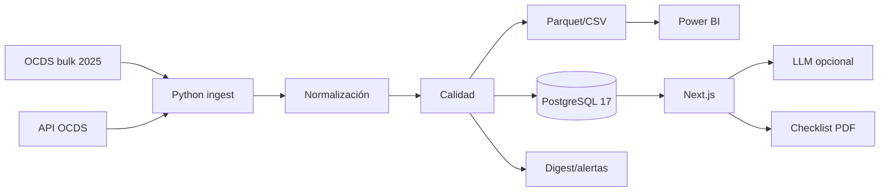

# ContrataMYPE

**Compras públicas explicadas para MYPEs.**

ContrataMYPE convierte las contrataciones abiertas del OECE (estándar OCDS) en un buscador de oportunidades para micro y pequeñas empresas, un checklist de participación y un dashboard reproducible del mercado de compras públicas del Perú.

> **Estado:** v0.1.0 — auditoría de datos 2025 completada (124,538 actualizaciones; cohorte 2025 de 59,141). Pipeline y producto en construcción; ver [`ROADMAP.md`](ROADMAP.md).

---

## Problema

Una MYPE no sabe qué licitaciones le convienen, qué documentos necesita ni cuándo vence el plazo. Los analistas tampoco tienen una vista simple del mercado, y los compradores no ven con claridad la competencia. La información existe en OCDS, pero está dispersa y en formato técnico.

ContrataMYPE responde:

- ¿Qué oportunidades son compatibles con mi rubro, región y tamaño?
- ¿Qué requisitos y plazos tengo que revisar?
- ¿Qué tan concentrado está el mercado por región, rubro y entidad?
- ¿Qué evidencia de calidad respalda estos números?

## Usuarios

1. **MYPE** — buscar, entender y descargar un checklist.
2. **Analista/periodista** — dashboard de mercado y exploración.
3. **Comprador/entidad** — vista read-only de mercado y competencia.

## Qué incluye (v1.0.0)

- **Web app Next.js** con búsqueda por texto, región, rubro, categoría, monto y estado.
- **Detalle de oportunidad** con entidad, objeto, valor, fechas, categoría y enlaces oficiales.
- **MYPE fit** heurístico (monto + rubro + región), etiquetado como “compatible”, nunca como elegibilidad legal.
- **Checklist/PDF** con pasos y documentos.
- **Explicador LLM** acotado a campos oficiales, con citas y disclaimer; fallback a plantilla si no hay API key.
- **Dashboard Power BI** con mercado por región/rubro/monto/evolución y participación MYPE.
- **Alertas** por digest CSV/email y adaptador Power Automate (si hay licencia).
- **Calidad de datos** con validaciones, reporte y checksums.

## Fuente de datos

- **OCDS / OECE** — Portal de Contrataciones Abiertas.
- Bulk anual JSONL: `https://data.open-contracting.org/es/publication/135/download?name=2025.jsonl.gz`
- 2025: **148.7 MB comprimido**, CC BY 4.0; **124,538 actualizaciones**, cohorte 2025 **59,141**.
- API: `https://contratacionesabiertas.oece.gob.pe/api/v1` (beta; 20 procesos/página).
- Campos: `ocid`, comprador, `parties` (RUC/departamento), `tender` (título, descripción, categoría, método, valor, fechas), `awards`, `contracts`.

Los archivos crudos no se commitean. La procedencia, hashes y perfil se documentan en `data/raw/README.md` y `docs/`.

## Arquitectura



**Stack:** Python 3.13, Polars/DuckDB, PostgreSQL 17, Next.js (App Router, TypeScript), Power BI (PBIP/PBIX), Playwright, pytest, Ruff, GitHub Actions.

## Demo

> Capturas y URL local se completan al cerrar la Fase 4. No se inventan resultados.

## Cómo correrlo (se completa por fase)

```bash
# Fase 1: auditoría
python tools/audit_ocds.py --input data/raw/ocds/2025.jsonl.gz

# Fase 2: pipeline
python -m contratamype run --year 2025

# Fase 4: web
cd web && npm install && npm run dev
```

## Calidad y límites

- La regla MYPE es una **heurística de compatibilidad**, no asesoría legal.
- No se scrapea SEACE/OECE: se usan datos abiertos, API y bulk.
- Los datos pueden tener duplicados, montos en 0, fechas incompletas y proveedores sin dirección; se reportan.
- El dashboard y la web no reemplazan los portales oficiales ni los plazos publicados.
- No hay cuentas de usuario ni pagos en v1.0.0.

## Licencia y atribución

Código MIT. Datos: OECE, Portal de Contrataciones Abiertas, estándar OCDS, redistribuidos por el Registro de Datos de Open Contracting Partnership bajo **CC BY 4.0**. ContrataMYPE no está afiliado al OECE.
