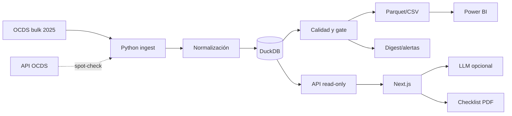

# ContrataMYPE

**Compras públicas explicadas para MYPEs.**

ContrataMYPE convierte las contrataciones abiertas del OECE (estándar OCDS) en un buscador de oportunidades para micro y pequeñas empresas, un checklist de participación y un dashboard reproducible del mercado de compras públicas del Perú.

> **Estado:** v1.0.0 en preparación — pipeline OCDS, calidad y digest de alertas cerrados; dashboard Power BI y web Next.js en integración. Ver [`ROADMAP.md`](ROADMAP.md) para la evidencia por fase.

---

## Problema

Una MYPE no sabe qué licitaciones le convienen, qué documentos necesita ni cuándo vence el plazo. Los analistas tampoco tienen una vista simple del mercado, y los compradores no ven con claridad la competencia. La información existe en OCDS, pero está dispersa y en formato técnico.

ContrataMYPE responde:

- ¿Qué oportunidades son compatibles con mi rubro, región y tamaño?
- ¿Qué requisitos y plazos tengo que revisar?
- ¿Qué tan concentrado está el mercado por región, rubro y entidad?
- ¿Qué evidencia de calidad respalda estos números?

## Usuarios

1. **MYPE** — buscar, entender y descargar un checklist.
2. **Analista/periodista** — dashboard de mercado y exploración.
3. **Comprador/entidad** — vista read-only de mercado y competencia.

## Qué incluye (v1.0.0)

- **Web app Next.js** con búsqueda por texto, región, rubro, categoría, monto y estado.
- **Detalle de oportunidad** con entidad, objeto, valor, fechas, categoría y enlaces oficiales.
- **MYPE fit** heurístico (monto + rubro + región), etiquetado como “compatible”, nunca como elegibilidad legal.
- **Checklist/PDF** con pasos y documentos.
- **Explicador LLM** acotado a campos oficiales, con citas y disclaimer; fallback a plantilla si no hay API key.
- **Dashboard Power BI** con mercado por región/rubro/monto/evolución y participación MYPE.
- **Alertas** por digest CSV/email y adaptador Power Automate (si hay licencia).
- **Calidad de datos** con validaciones, reporte y checksums.

## Fuente de datos

- **OCDS / OECE** — Portal de Contrataciones Abiertas.
- Bulk anual JSONL: `https://data.open-contracting.org/es/publication/135/download?name=2025.jsonl.gz`
- 2025: **148.7 MB comprimido**, CC BY 4.0; **124,538 actualizaciones**, cohorte 2025 **59,141**.
- API: `https://contratacionesabiertas.oece.gob.pe/api/v1` (beta; 20 procesos/página).
- Campos: `ocid`, comprador, `parties` (RUC/departamento), `tender` (título, descripción, categoría, método, valor, fechas), `awards`, `contracts`.

Los archivos crudos no se commitean. La procedencia, hashes y perfil se documentan en `data/raw/README.md` y `docs/`.

## Hallazgos 2025

- **59,141 procesos** por **S/ 66.62 mil millones**; **34,486 (58.3%)** son
  compatibles con la heurística MYPE, pero suman solo **S/ 2.95 mil millones
  (4.4% del valor)**.
- `goods` y `services` concentran la MYPE (67.8% y 63.6% de sus procesos);
  `works` queda fuera de la regla y explica la brecha de monto.
- Lima tiene el 27.6% de los procesos y el 43.1% del monto; Cusco, Puno y
  Ayacucho muestran mayor proporción MYPE.
- 4,952 procesos (8.4%) traen monto 0 (“no informado”), no gratuito.
- Detalle y SQL de reproducción en [`docs/market-findings-2025.md`](docs/market-findings-2025.md).

## Arquitectura



**Stack:** Python 3.13, DuckDB/PyArrow, FastAPI, Next.js (App Router, TypeScript),
Power BI (PBIP/PBIX), Playwright, pytest, Ruff. Local-first; PostgreSQL queda
como adaptador pendiente (ver `docs/architecture.md`).

## Documentación

- [`SPECS.md`](SPECS.md) — alcance y contrato del producto.
- [`ROADMAP.md`](ROADMAP.md) — fases, evidencia y checkpoints.
- [`docs/architecture.md`](docs/architecture.md) — componentes y ADRs.
- [`docs/data-dictionary.md`](docs/data-dictionary.md) — granos y campos.
- [`docs/quality-checks.md`](docs/quality-checks.md) — 12 checks y gate.
- [`docs/market-findings-2025.md`](docs/market-findings-2025.md) — hallazgos reales.
- [`docs/alerts.md`](docs/alerts.md) — digest y Power Automate.
- [`docs/release.md`](docs/release.md) — bundle y tag local.

## Cómo correrlo

```bash
# 0. Entorno
py -3.13 -m venv .venv
.\.venv\Scripts\python.exe -m pip install -e ".[dev]"

# 1. Pipeline (bulk local, gitignored)
python -m contratamype run \
  --input data/raw/ocds/2025.jsonl.gz \
  --artifacts artifacts/2025 \
  --db data/processed/contratamype.duckdb

# 2. API y web (ver docs/web.md)
uvicorn api.app:app --port 8000
cd web && npm install && npm run dev

# 3. Alertas
python -m contratamype digest --artifacts artifacts/2025 --since 2025-01-01

# 4. Tests: rápido por defecto; lento solo en checkpoint
pytest -m fast
pytest -m slow
```

## Calidad y límites

- La regla MYPE es una **heurística de compatibilidad**, no asesoría legal.
- No se scrapea SEACE/OECE: se usan datos abiertos, API y bulk.
- Los datos pueden tener duplicados, montos en 0, fechas incompletas y proveedores sin dirección; se reportan.
- El dashboard y la web no reemplazan los portales oficiales ni los plazos publicados.
- No hay cuentas de usuario ni pagos en v1.0.0.

## Licencia y atribución

Código MIT. Datos: OECE, Portal de Contrataciones Abiertas, estándar OCDS, redistribuidos por el Registro de Datos de Open Contracting Partnership bajo **CC BY 4.0**. ContrataMYPE no está afiliado al OECE.
