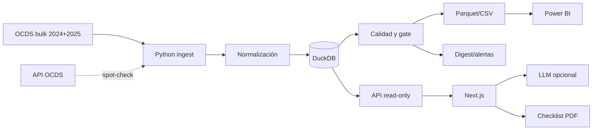

# ContrataMYPE

**Compras públicas explicadas para MYPEs.**

ContrataMYPE convierte las contrataciones abiertas del OECE (estándar OCDS) en un buscador de oportunidades para micro y pequeñas empresas, un checklist de participación y un dashboard reproducible del mercado de compras públicas del Perú.

> **Estado:** v1.1.0 — cohortes 2024 + 2025, web/API, dashboard, alertas y bundle verificable. El test con una persona MYPE queda como validación manual pendiente. Ver [`ROADMAP.md`](ROADMAP.md) y [`docs/v1.1-plan.md`](docs/v1.1-plan.md).

---

## Problema

Una MYPE no sabe qué licitaciones le convienen, qué documentos necesita ni cuándo vence el plazo. Los analistas tampoco tienen una vista simple del mercado, y los compradores no ven con claridad la competencia. La información existe en OCDS, pero está dispersa y en formato técnico.

ContrataMYPE responde:

- ¿Qué oportunidades son compatibles con mi rubro, región y tamaño?
- ¿Qué requisitos y plazos tengo que revisar?
- ¿Qué tan concentrado está el mercado por región, rubro y entidad?
- ¿Qué evidencia de calidad respalda estos números?

## Usuarios

1. **MYPE** — buscar, entender y descargar un checklist.
2. **Analista/periodista** — dashboard de mercado y exploración.
3. **Comprador/entidad** — vista read-only de mercado y competencia.

## Qué incluye (v1.1.0)

- **Web app Next.js** con búsqueda por texto, región, categoría (rubro OCDS), monto, método y **año (Todos/2024/2025)**. El estado no viene informado en los bulk; la UI lo explica.
- **Detalle de oportunidad** con entidad, objeto, valor, fechas, categoría y enlaces oficiales.
- **MYPE fit** heurístico (monto > 0 + rubro + región), etiquetado como “compatible”, nunca como elegibilidad legal.
- **Checklist/PDF** con pasos y documentos.
- **Explicador** con plantilla determinista, citas y disclaimer; adaptador Gemini opcional solo para la introducción.
- **Dashboard Power BI** con mercado 2024–2025, selector de año, región/rubro/monto/evolución y participación MYPE.
- **Alertas** por digest CSV/email y adaptador Power Automate (si hay licencia).
- **Calidad de datos** con 12 validaciones, auditorías de cobertura y checksums.

## Fuente de datos

- **OCDS / OECE** — Portal de Contrataciones Abiertas.
- Bulks anuales JSONL: `2024.jsonl.gz` y `2025.jsonl.gz` desde `https://data.open-contracting.org/es/publication/135/download?name=<año>.jsonl.gz`.
- 2024: **125.6 MB comprimido**, cohorte same-year **46,328**; 2025: **148.7 MB**, cohorte **59,141**.
- Cohorte fusionada 2024–2025 (incluye actualizaciones cross-year): **64,783 + 59,148 = 123,931 procesos**.
- API: `https://contratacionesabiertas.oece.gob.pe/api/v1` (beta; 20 procesos/página).
- Campos: `ocid`, comprador, `parties` (RUC/departamento), `tender` (título, descripción, categoría, método, valor, fechas), `awards`, `contracts`.

Los archivos crudos no se commitean. La procedencia, hashes y perfil se documentan en `data/raw/README.md` y `docs/`.

## Hallazgos 2024–2025

- **123,931 procesos** por **S/ 158.34 mil millones**; **58,380 (47.1%)** son
  compatibles con la heurística MYPE, pero suman solo **S/ 5.77 mil millones
  (3.6% del valor)**.
- Por año: 2024 = **64,783 procesos / S/ 91.70 mil millones / 28,458 MYPE**;
  2025 = **59,148 / S/ 66.64 mil millones / 29,922 MYPE**.
- `goods` (56,420) y `services` (54,120) concentran la MYPE; `works` (13,391)
  queda fuera de la regla y explica la brecha de monto.
- **14,335 procesos (11.6%)** traen monto 0 (“no informado”) y no se marcan
  compatibles; **116,384 (93.9%)** registran inicio = fin del período.
- 94,570 procesos (76.3%) tienen adjudicación y 85,496 (69.0%) contrato.
- Detalle combinado en [`docs/market-findings-2024-2025.md`](docs/market-findings-2024-2025.md); perfil 2025 en [`docs/market-findings-2025.md`](docs/market-findings-2025.md) y plan multi-año en [`docs/v1.1-plan.md`](docs/v1.1-plan.md).

## Arquitectura



**Stack:** Python 3.13, DuckDB/PyArrow, FastAPI, Next.js (App Router, TypeScript),
Power BI (PBIP/PBIX), Playwright, pytest, Ruff. Local-first; PostgreSQL queda
como adaptador pendiente (ver `docs/architecture.md`).

## Estructura del repositorio

| Ruta | Contenido |
|---|---|
| `contratamype/` | Ingesta OCDS, normalización, DuckDB, 12 checks, exports y digest |
| `api/` | API FastAPI read-only sobre DuckDB |
| `web/` | Next.js App Router, búsqueda, detalle, checklist y PDF |
| `dashboard/` | PBIP/PBIX y capturas de Power BI |
| `tests/e2e/` | E2E de pipeline, alertas y release |
| `tools/` | Auditorías y muestras reproducibles |
| `docs/` | Decisiones, diccionario, calidad, hallazgos y límites |
| `data/raw/`, `data/processed/`, `artifacts/` | Datos y artefactos locales (gitignored) |

## Documentación

- [`SPECS.md`](SPECS.md) — alcance y contrato del producto.
- [`ROADMAP.md`](ROADMAP.md) — fases, evidencia y checkpoints.
- [`docs/architecture.md`](docs/architecture.md) — componentes y ADRs.
- [`docs/data-dictionary.md`](docs/data-dictionary.md) — granos y campos.
- [`docs/quality-checks.md`](docs/quality-checks.md) — 12 checks y gate.
- [`docs/market-findings-2025.md`](docs/market-findings-2025.md) — hallazgos 2025.
- [`docs/market-findings-2024-2025.md`](docs/market-findings-2024-2025.md) — hallazgos combinados.
- [`docs/v1.1-plan.md`](docs/v1.1-plan.md) — cohortes 2024–2025, conteos y alcance.
- [`docs/alerts.md`](docs/alerts.md) — digest y Power Automate.
- [`docs/release.md`](docs/release.md) — bundle y tag local.

## Cómo correrlo

```bash
# 0. Entorno
py -3.13 -m venv .venv
.\.venv\Scripts\python.exe -m pip install -e ".[dev]"

# 1. Pipeline (bulks locales, gitignored)
python -m contratamype run \
  --input data/raw/ocds/2024.jsonl.gz \
  --input data/raw/ocds/2025.jsonl.gz \
  --artifacts artifacts/2025 \
  --db data/processed/contratamype.duckdb

# 2. API y web (ver docs/web.md)
uvicorn api.app:app --port 8000
cd web && npm install && npm run dev

# 3. Alertas (cohortes 2024–2025)
python -m contratamype digest --artifacts artifacts/2025 --since 2024-01-01

# 4. Tests: rápido por defecto; lento solo en checkpoint
pytest -m fast
pytest -m slow
```

## Testing

| Tier | Comando | Cuándo | Cobertura |
|---|---|---|---|
| Fast | `pytest -m fast` | Después de cada cambio; segundos | Fixtures deterministas, gate, exports, digest, release |
| Slow | `pytest -m slow` | Solo checkpoint/release; ~55 s | Bulks 2024+2025 reales (local, gitignored) |
| Full | `pytest -m "fast or slow"` | Antes de cerrar release | Fast + slow |
| Web | `cd web && npx playwright test` | Al tocar web/API | 23 E2E con seed determinista |
| Power BI | `powerbi-report-author validate` + capturas | Al tocar dashboard | PBIR/PBIP y evidencia visual |

`pytest.ini` excluye `slow` por defecto. El CI corre `pytest -m fast` y Playwright
con el seed determinista; el bulk nunca se sube al repo.

## Calidad y límites

- La regla MYPE es una **heurística de compatibilidad**, no asesoría legal.
- No se scrapea SEACE/OECE: se usan datos abiertos, API y bulk.
- Los datos pueden tener duplicados, montos en 0, fechas incompletas y proveedores sin dirección; se reportan.
- El dashboard y la web no reemplazan los portales oficiales ni los plazos publicados.
- No hay cuentas de usuario ni pagos en v1.1.0.

## Licencia y atribución

Código MIT. Datos: OECE, Portal de Contrataciones Abiertas, estándar OCDS, redistribuidos por el Registro de Datos de Open Contracting Partnership bajo **CC BY 4.0**. ContrataMYPE no está afiliado al OECE.
