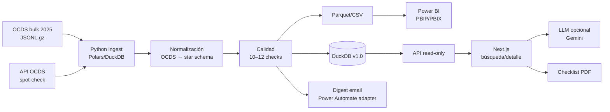

# SPECS — ContrataMYPE

> **Versión:** v0.1.0 (auditoría de datos) → v1.0.0 (producto).
> **Estado:** documentos iniciales; la ventana de datos y el umbral MYPE se cierran con la auditoría 2025.
> **Fuente:** OECE — Portal de Contrataciones Abiertas (OCDS), datos abiertos CC BY 4.0.

## 1. Problema

Las MYPEs peruanas no acceden a compras públicas por tres barreras: no encuentran oportunidades relevantes, no entienden los requisitos/plazos y no tienen una forma simple de priorizar. Los analistas y periodistas tampoco tienen una vista reproducible del mercado de contrataciones; los compradores no ven con claridad la competencia y la participación MYPE.

## 2. Usuarios

| Prioridad | Usuario | Necesita |
|---|---|---|
| 1 | **MYPE** | Buscar oportunidades compatibles, entender requisitos/plazos, descargar un checklist y recibir alertas. |
| 2 | **Analista/periodista** | Ver el mercado por región, rubro, monto, entidad y evolución; detectar patrones y concentración. |
| 3 | **Comprador/entidad** | Una vista de mercado y competencia (read-only), no un backoffice de compras. |

**Decisión:** un solo core de datos y tres vistas. No se construyen tres productos separados.

## 3. Alcance v1.0.0

### Web app (Next.js)
- Búsqueda por texto, región, rubro, categoría, monto y estado.
- Detalle de oportunidad: entidad, objeto, valor, fechas, categoría, requisitos disponibles y enlaces oficiales.
- **MYPE fit** heurístico: monto + rubro + región; etiqueta “compatible”, nunca “elegible legalmente”.
- Checklist/PDF descargable con pasos y documentos.
- Explicador LLM **acotado a campos oficiales**, con citas y disclaimer; si no hay API key, fallback a plantilla.
- Sin cuentas de usuario en v1.0: búsqueda y checklist públicos; alertas por email/digest.

### Power BI
- Página 1: mercado (procesos, montos, regiones, rubros, evolución, participación MYPE).
- Página 2: explorador de oportunidades (filtros + tabla), sin duplicar la búsqueda de la web app.
- PBIP/PBIX, capturas y modelo documentado.

### Alertas
- Digest CSV/email con oportunidades nuevas compatibles.
- Adaptador Power Automate si la cuenta/licencia está disponible; si no, el flujo queda documentado y se simula localmente.

## 4. Fuente de datos

### Bulk OCDS (principal)
- Registro de Datos de Open Contracting Partnership, publicación OECE.
- `https://data.open-contracting.org/es/publication/135/download?name=2025.jsonl.gz`
- **2025: 148.7 MB comprimido**, JSONL, CC BY 4.0.
- Cobertura 2003–hoy; un proceso por línea; actualización diaria/mensual.
- Campos: `ocid`, `date`, `buyer`, `parties` (RUC/departamento), `tender` (título, descripción, categoría, método, valor PEN, fechas), `awards`, `contracts`.

### API OCDS (complemento)
- Base: `https://contratacionesabiertas.oece.gob.pe/api/v1`.
- `GET /records?sourceId=seace_v3&dataSegmentationID=YYYY-MM&page=N` → 20 procesos/página, `compiledRelease`, `releases`, `parties`, `awards`, `contracts`.
- Sin filtro nativo por departamento: `parties[].address.department` se filtra del lado del cliente.
- Beta; usar para spot-checks y meses recientes, no para el volumen principal.

### Ventana
- **Auditoría 2025:** 124,538 actualizaciones; cohorte `dataSegmentation` 2025 = **59,141 procesos**.
- **v1.0.0:** cohorte 2025 (59,141). Los 124,538 se cargan con `segmentation_year` para búsqueda/historia, pero el dashboard y el buscador filtran 2025 por defecto.
- **2024–2025:** v1.1; requiere el bulk 2024 y deduplicar OCIDs entre snapshots.
- No se promete 2018–2025.

### Problemas de calidad conocidos
Postores duplicados, estados vacíos, montos en 0, `tenderPeriod` con inicio = fin, proveedores sin dirección, adjudicaciones/contratos no siempre vinculados y API beta. Se medirán y reportarán; no se ocultarán.

## 5. Arquitectura



- **Python** para ingesta, normalización, calidad y exports.
- **DuckDB/PyArrow** para el audit, las transformaciones y el serving local; **PostgreSQL 17** como adaptador pendiente, no bloquea v1.0.
- **Next.js (App Router, TypeScript)** para la web.
- **Power BI** para el dashboard de mercado.
- **Sin Spark:** el bulk anual es ~150 MB; Spark no aporta y complica el entorno.

## 6. Modelo de datos

### Hechos
- `fact_tender` — un proceso: `ocid`, `buyer_id`, `department_code`, `category`, `method`, `amount_pen`, `published_date`, `tender_start`, `tender_end`, `status`, `mype_fit`.
- `fact_award` — una adjudicación/proveedor: `ocid`, `award_id`, `supplier_id`, `amount_pen`, `award_date`, `status`.
- `fact_contract` — un contrato: `ocid`, `contract_id`, `award_id`, `amount_pen`, `signed_date`, `status`.

### Dimensiones
- `dim_buyer` — id, nombre, RUC, departamento, localidad.
- `dim_supplier` — id, nombre, RUC, departamento.
- `dim_department` — código INEI, nombre.
- `dim_category` — `goods`/`services`/`works` y etiqueta.
- `dim_date` — fecha.

### MYPE fit
Regla transparente y configurable:
```
mype_fit = amount_pen > 0
           AND amount_pen <= threshold
           AND category IN target_categories
           AND department IN target_departments
```
- `threshold` default propuesto: **S/ 200,000** (59.7% de la cohorte 2025), configurable; se elige con la distribución real y no se hardcodea.
- `amount_pen = 0` significa **no informado**; no se marca como compatible porque no se puede evaluar el monto.
- La etiqueta es **“compatible”**, no elegibilidad legal. Disclaimer visible.
- Se documenta la regla y se puede cambiar por configuración.

## 7. Calidad de datos

10–12 validaciones, como mínimo:
1. schema/campos obligatorios por registro;
2. `ocid` único y no nulo;
3. fechas parseables y en rango;
4. montos no negativos; `0` se reporta como no informado;
5. categoría en `{goods, services, works}`;
6. departamento en los 25 departamentos;
7. comprador con nombre/id;
8. awards con proveedor y monto, o estado explícito;
9. contracts vinculados a award cuando exista;
10. duplicados de postores/proveedores;
11. cobertura de meses/regiones;
12. consistencia API vs bulk en una muestra.

Cada check produce conteos y una muestra de fallos; el reporte se publica como artefacto con checksums.

## 8. E2E (definir antes de implementar)

### Pipeline
- Escenario medio-difícil: un mes/departamento con **duplicados, monto 0, fecha inicio=fin, award sin contrato, proveedor sin dirección y un registro con categoría inválida**.
- El E2E exige que las 10–12 validaciones detecten exactamente lo inyectado, que el gate bloquee/publicar según corresponda y que el artefacto (`quality_report.json`, `run_manifest.json`, `checksums.sha256`) sea verificable.
- El dataset de prueba se genera determinista; el bulk real se usa en local, no en CI.

### Web
- Playwright con un dataset sembrado: búsqueda por región/rubro, detalle de una oportunidad con datos incompletos, checklist/PDF y estado vacío.
- Escenario medio-difícil: una oportunidad con descripción faltante, una con monto 0, una con award y otra sin award; la UI debe explicar los vacíos, no romperse.

### Power BI
- `powerbi-report-author validate` 0 errores/0 warnings; capturas Desktop; modelo refrescado con el dataset de prueba.
- No se considera terminado solo con “valida”.

## 9. No objetivos v1.0.0

- Asesoría legal o determinar elegibilidad legal.
- Scraping de SEACE/OECE; solo datos abiertos/API/bulk.
- Backoffice de compras o gestión de procesos.
- Cobertura 2018–2025 completa si el audit muestra que no es viable.
- Publicación en Power BI Service (se evalúa en v1.1).
- Cuentas de usuario, pagos o alertas WhatsApp.

## 10. Riesgos

- API OCDS beta y posible bloqueo a clientes automatizados.
- Calidad y duplicados del bulk; campos vacíos.
- LLM sin API key o con hallucination; se mitiga con plantilla/citas/disclaimer.
- Power Automate sin licencia; se mitiga con digest local.
- Doble stack Python + Next.js; se mitiga con boundaries claros y E2E.
- Volumen 2024–2025; se decide con el audit.

## 11. Criterios de aceptación v1.0.0

- [x] Audit 2025 con conteos, calidad, SHA-256 y decisión de ventana.
- [x] Pipeline E2E con escenario medio-difícil y artefactos verificables.
- [x] DuckDB/Parquet con star schema y 12 validaciones (PostgreSQL 17 diferido; ADR-0001).
- [ ] Power BI PBIP/PBIX validado y capturado.
- [x] Web Next.js con búsqueda, detalle, MYPE fit, checklist/PDF y disclaimers.
- [ ] LLM acotado o fallback plantilla, con evaluación y citas.
- [x] Alertas digest + adaptador Power Automate (o documentado).
- [x] README ES/EN, data dictionary, architecture, SPECS/ROADMAP/CODESTYLE/AGENTS.
- [ ] Release v1.0.0 con artefactos y checksums.
