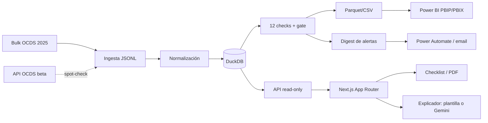

# Arquitectura — ContrataMYPE v1.0.0

## 1. Vista general



La regla MYPE se calcula **una sola vez** en el pipeline (`mype_fit`). La web y
Power BI la leen; no la duplican.

## 2. Componentes

| Componente | Responsabilidad | No hace |
|---|---|---|
| `contratamype/` (Python) | Ingesta, normalización, star schema DuckDB, calidad, exports, digest | No sirve HTTP ni renderiza UI |
| `api/` (FastAPI) | Lectura paginada y detalle sobre DuckDB; checklist JSON | No escribe, no recalcula MYPE |
| `web/` (Next.js) | Búsqueda, detalle, checklist/PDF, explicador | No accede a OCDS ni recalcula reglas |
| `dashboard/` (Power BI) | Historia de mercado y explorador | No consulta la base de la web |
| `contratamype/alerts.py` | Digest determinista y deduplicado | No envía correo por sí solo |

## 3. Flujo de datos

1. `data/raw/ocds/2025.jsonl.gz` (148.7 MB, gitignored) se procesa en streaming.
2. Cada `compiledRelease` se normaliza a filas planas.
3. DuckDB carga por lotes vectorizados (PyArrow) y deduplica por claves.
4. Los 12 checks escriben `quality_report.json`; un `fail` bloquea exports.
5. Si el gate está abierto: Parquet/CSV + `run_manifest.json` + `checksums.sha256`.
6. La API lee la misma base en modo read-only; la web consume la API.
7. El digest lee la base, exige el gate abierto y deduplica por OCID.

## 4. Decisiones (ADR)

### ADR-0001 — DuckDB en vez de PostgreSQL para v1.0 local

- **Contexto:** Docker Desktop no está disponible en la máquina de desarrollo;
  el volumen es 124k procesos y 150 MB comprimidos.
- **Decisión:** DuckDB como store analítico y base read-only de la API local.
- **Tradeoff:** no hay concurrencia multi-escritor ni despliegue serverless;
  se gana reproducibilidad y cero servicios externos.
- **Pendiente:** adaptador PostgreSQL 17 cuando haya Docker/servicio disponible.
  La API aísla el cambio de motor.

### ADR-0002 — Cohorte 2025, no 2024–2025

- **Contexto:** el bulk 2025 es un snapshot de actualizaciones, no una serie
  histórica limpia; cruzar snapshots requiere deduplicar OCIDs entre años.
- **Decisión:** v1.0 usa `dataSegmentation` 2025 (59,141 procesos) y conserva
  los 124,538 registros para búsqueda/historia.
- **Tradeoff:** se pierde la comparación anual; se evita una falsa serie.

### ADR-0003 — `contract_award_linked` es warning, no bloqueo

- **Contexto:** 4.8% de contratos referencia un award ausente del
  `compiledRelease`; el campo `awardID` existe en el 100%.
- **Decisión:** reportar conteo y muestra, no bloquear. Fabricar el award
  violaría la fuente.
- **Tradeoff:** la app debe explicar el contrato sin proveedor en vez de
  ocultarlo.

### ADR-0004 — API read-only como boundary

- **Contexto:** `AGENTS.md` permite que la web lea “PostgreSQL/API”.
- **Decisión:** una API FastAPI mínima sobre DuckDB; la web no importa DuckDB
  ni conoce el esquema físico más allá del contrato HTTP.
- **Tradeoff:** un proceso más que arrancar; a cambio, el motor se puede
  cambiar sin tocar la UI.

### ADR-0005 — Explicador con fallback de plantilla

- **Contexto:** no hay API key de Gemini verificada.
- **Decisión:** la explicación por plantilla es el camino por defecto; el
  adaptador Gemini es opcional y nunca decide elegibilidad.
- **Tradeoff:** menos fluidez lingüística; cero dependencia de red y cero
  alucinaciones de requisitos.

## 5. Reproducibilidad

```bash
# 1. Pipeline (bulk local)
python -m contratamype run \
  --input data/raw/ocds/2025.jsonl.gz \
  --artifacts artifacts/2025 \
  --db data/processed/contratamype.duckdb

# 2. API
uvicorn api.app:app --port 8000

# 3. Web
cd web && npm install && npm run dev

# 4. Tests
pytest -m fast            # segundos, default
pytest -m slow            # bulk local, checkpoint
```

## 6. Límites conocidos

- El bulk es un snapshot; la API OCDS está más fresca (spot-check 9/20, 0 diferencias).
- Fechas de plazo incompletas y `inicio = fin` en 93.3% de la cohorte.
- Sin autenticación ni cuentas en v1.0.
- Power BI se publica como archivo local, no en Power BI Service.
